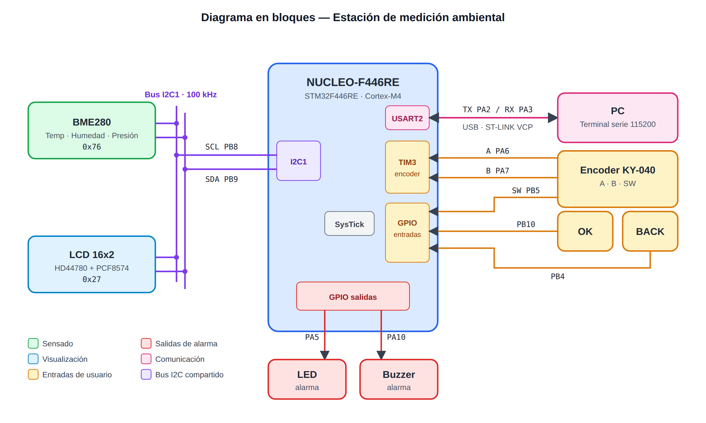
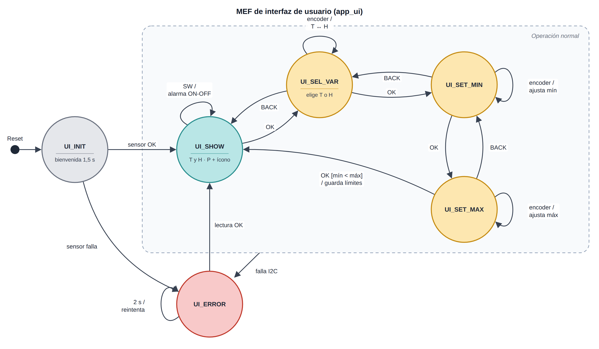
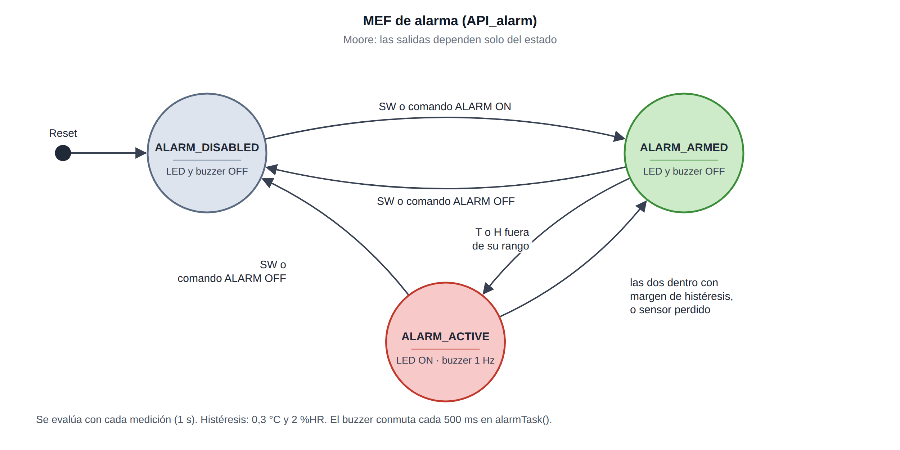
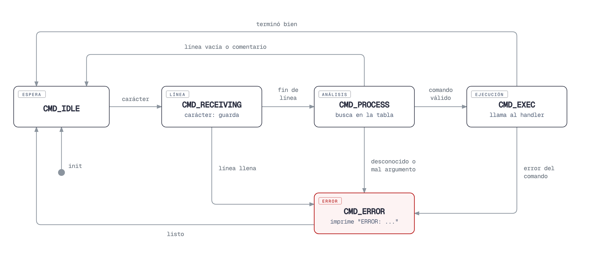
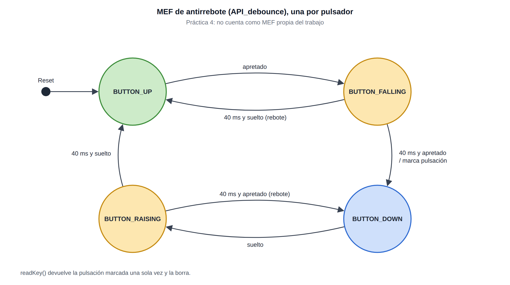

# Estación de medición ambiental

Trabajo final de Programación de Microcontroladores (CESE - FIUBA).

La estación mide temperatura, humedad y presión con un BME280 una vez por
segundo y las muestra en un LCD de 16x2. La temperatura y la humedad tienen
límites de alarma que se ajustan con un encoder; si alguna sale de su rango se
encienden un LED y un buzzer. La presión solo se muestra. Todo se puede
consultar y configurar también desde una consola serie.

Corre sobre una **NUCLEO-F446RE** y parte de los módulos hechos en las
prácticas del curso: el retardo no bloqueante, el antirrebote y la UART con el
intérprete de comandos.

## Hardware

| Componente | Interfaz | Pines (conector Arduino) |
|---|---|---|
| BME280, dirección 0x76 | I2C1 a 100 kHz | PB8 SCL (D15), PB9 SDA (D14) |
| LCD 16x2 con PCF8574, dirección 0x27 | I2C1, mismo bus | PB8, PB9 |
| Encoder KY-040 | TIM3 en modo encoder | PA6 (D12), PA7 (D11) |
| Pulsador del encoder (SW) | GPIO con pull-up | PB5 (D4) |
| Pulsador BACK | GPIO con pull-up | PB4 (D5) |
| Pulsador OK | GPIO con pull-up | PB10 (D6) |
| Buzzer activo | GPIO de salida | PA10 (D2) |
| LED de alarma | GPIO de salida | PA5, es LD2 de la placa |
| Consola | USART2, 115200 8N1 | PA2/PA3, por el USB del ST-LINK |

El LCD y el BME280 van a 5 V: con 3,3 V el LCD casi no se ve, y el módulo del
BME280 tiene su propio regulador. Las entradas que usan 5 V (I2C y encoder)
están en pines tolerantes a 5 V.



## Cómo se usa

Al encender aparece una pantalla de bienvenida y, a los 1,5 s, la principal:

```
T:24.8°C H: 55%       temperatura y humedad
P: 1007.1 hPa  X     presión y estado de la alarma
```

La campana es un caracter propio cargado en el LCD: llena si la alarma está
habilitada, vacía si no. Cuando la alarma se dispara la segunda fila dice qué
pasó, por ejemplo `ALARMA T ALTA`, y la campana parpadea al ritmo del buzzer.
La humedad va sin decimal porque el sensor tiene ±3 %HR de precisión; así la
fila entra en las 16 columnas.

- **SW del encoder:** habilita o deshabilita la alarma.
- **OK:** entra a editar límites. Con el encoder se elige temperatura o humedad,
  y después se ajustan el mínimo y el máximo. El último OK guarda.
- **BACK:** vuelve un paso sin guardar.

Mientras se edita, el encoder no deja que el mínimo pase al máximo ni que
alguno salga de lo que mide el sensor. Los límites arrancan en 10 a 35 °C y
20 a 80 %HR.

La consola atiende estos comandos:

| Comando | Qué hace |
|---|---|
| `GET` | muestra las tres mediciones |
| `LIM?` | muestra los límites y la histéresis de temperatura y humedad |
| `SET <T\|H> <min> <max>` | cambia los límites, por ejemplo `SET T 18 30` |
| `HYST <T\|H> <valor>` | cambia la histéresis, por ejemplo `HYST T 0.5` |
| `ALARM <ON\|OFF>` | habilita o deshabilita la alarma |
| `STATUS` | estado de la interfaz y de la alarma |
| `HELP` | lista los comandos |

Además avisa sola cada cambio de estado, como `UI: SHOW -> SEL_VAR` o
`ALARMA: ARMED -> ACTIVE`.

## Máquinas de estados

El trabajo tiene cuatro MEF. Dos son propias y dos vienen de las prácticas:

| MEF | Módulo | Tipo | Origen |
|---|---|---|---|
| Interfaz de usuario | `app_ui` | Mealy | propia |
| Alarma | `API_alarm` | Moore | propia |
| Intérprete de comandos | `API_cmdparser` | — | prácticas |
| Antirrebote, una por pulsador | `API_debounce` | — | prácticas |

Todas siguen el mismo esquema: un `enum` privado con los estados, una
variable `static` con el estado actual, una función que inicializa y otra que
actualiza con un `switch`, y un `default` que vuelve a un estado conocido.

### Interfaz de usuario

Es la MEF principal: decide qué muestra el LCD y qué hace cada botón. Es de
Mealy porque lo importante pasa en las transiciones: copiar los límites al
entrar a editar, guardarlos al confirmar, silenciar la alarma si se pierde el
sensor.



| Estado | Evento | Acción | Pasa a |
|---|---|---|---|
| `UI_INIT` | pasaron 1,5 s y el sensor responde | primera lectura | `UI_SHOW` |
| `UI_INIT` | el sensor no responde | | `UI_ERROR` |
| `UI_SHOW` | SW | habilita o deshabilita la alarma | `UI_SHOW` |
| `UI_SHOW` | OK | | `UI_SEL_VAR` |
| `UI_SEL_VAR` | encoder | alterna T y H | `UI_SEL_VAR` |
| `UI_SEL_VAR` | OK | copia los límites de esa variable | `UI_SET_MIN` |
| `UI_SEL_VAR` | BACK | | `UI_SHOW` |
| `UI_SET_MIN` | encoder | mínimo ± un paso | `UI_SET_MIN` |
| `UI_SET_MIN` | OK | | `UI_SET_MAX` |
| `UI_SET_MIN` | BACK | descarta la copia | `UI_SEL_VAR` |
| `UI_SET_MAX` | encoder | máximo ± un paso | `UI_SET_MAX` |
| `UI_SET_MAX` | OK y mínimo < máximo | guarda los límites | `UI_SHOW` |
| `UI_SET_MAX` | BACK | | `UI_SET_MIN` |
| cualquiera | falla una lectura | silencia la alarma | `UI_ERROR` |
| `UI_ERROR` | pasaron 2 s | libera el bus y reintenta | `UI_SHOW` si el sensor volvió |

La medición, la alarma y la consola corren en todos los estados: mientras se
edita un límite la alarma sigue evaluando con los anteriores.

### Alarma

Es de Moore: las salidas dependen solo del estado. En `ALARM_ACTIVE` el LED
queda encendido y el buzzer suena intermitente; en los otros dos, todo apagado.



| Estado | Evento | Pasa a |
|---|---|---|
| `ALARM_DISABLED` | SW o `ALARM ON` | `ALARM_ARMED` |
| `ALARM_ARMED` | T o H fuera de su rango | `ALARM_ACTIVE` |
| `ALARM_ARMED` | SW o `ALARM OFF` | `ALARM_DISABLED` |
| `ALARM_ACTIVE` | las dos dentro del rango con margen de histéresis | `ALARM_ARMED` |
| `ALARM_ACTIVE` | se perdió el sensor | `ALARM_ARMED` |
| `ALARM_ACTIVE` | SW o `ALARM OFF` | `ALARM_DISABLED` |

La histéresis (por defecto 0,3 °C y 2 %HR, ajustable por consola con `HYST`) evita que una medición que oscila justo en el
límite haga sonar y callar el buzzer cada segundo. Con el sensor perdido la
alarma se calla porque no hay dato para afirmar que siga fuera de rango.

### Intérprete de comandos y antirrebote

Son las MEF de las prácticas. El intérprete cambió en una cosa: los
comandos no están fijos en el módulo, la aplicación le pasa una tabla. El
antirrebote ahora tiene una instancia por pulsador.





## Organización del código

```
App/                     lo propio de esta aplicación
  app_ui                 MEF de interfaz y comandos de consola
  app_icons              íconos del LCD
  app_fmt                números con un decimal
  app_test               pruebas de un módulo por vez
Drivers/API/             módulos portables: ninguno incluye la HAL
Drivers/Port/STM32F4xx/  lo único que depende del micro
```

Las capas siguen la propuesta de device drivers de Protocolos:

- `API_lcd`, `API_bme280` y `API_encoder` solo saben hablar con su dispositivo.
- Cada uno tiene un `_port.c` corto que le da acceso al bus.
- `port_stm32f4xx.c` es el único archivo que usa la HAL: tiene el único handle
  de I2C (compartido por el LCD y el sensor), el timer del encoder, la UART y
  los GPIO.

Para llevarlo a otro micro alcanza con reescribir la carpeta `Port`.

| Módulo | Qué hace | Origen |
|---|---|---|
| `API_delay` | retardos no bloqueantes | prácticas |
| `API_debounce` | antirrebote de tres pulsadores | prácticas |
| `API_uart` | consola serie | prácticas |
| `API_cmdparser` | intérprete de comandos con tabla | prácticas |
| `API_gpio` | LED y buzzer | prácticas |
| `API_encoder` | pasos del encoder a partir del TIM3 | nuevo |
| `API_lcd` | LCD 16x2 por I2C | nuevo, a partir del ejemplo de Protocolos |
| `API_bme280` | lectura y compensación del sensor | nuevo |
| `API_alarm` | límites, histéresis y salidas | nuevo |
| `app_ui` | interfaz de usuario | nuevo |

Algunas decisiones:

- **El lazo no se queda esperando.** Todo se temporiza con `API_delay`. Solo
  esperan el arranque del LCD y del sensor, y las transferencias I2C, que
  duran unos pocos milisegundos.
- **La UART recibe por interrupción.** Por polling se perdían caracteres
  mientras el lazo escribía el LCD, porque el USART guarda uno solo. La
  interrupción guarda cada byte en un buffer circular y el intérprete los toma
  cuando puede.
- **El LCD manda cada texto en una sola transferencia I2C** en vez de cuatro
  por caracter, y una fila solo se reescribe si cambió.
- **El bus se recupera solo.** Si el sensor se desconecta en medio de una
  lectura puede quedar reteniendo SDA. Antes de reintentar, el port le da los
  pulsos de reloj que espera y una condición de STOP.
- **Variables encapsuladas.** Todo lo interno de cada módulo es `static`, y
  desde afuera se accede con funciones, como `alarmGetLimits()` y
  `alarmSetLimits()`.
- **Parámetros validados.** Cada función pública valida lo que recibe y
  devuelve un estado, que quien la llama revisa.

Cada módulo se probó solo en la placa antes de integrarlo. Esas pruebas
quedaron en `app_test` y se eligen con `APP_TEST` en `app_test.h`.

La documentación del código se genera con Doxygen a partir del `Doxyfile` de
esta carpeta.
